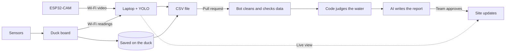

# BbiGeuDeok: Be Green Duck
>Check the water of Ingyeongho pond, measured by a duck robot.

  
  
  
  

The middle of the pond is hard to reach, so its water was rarely checked. A duck robot now visits five spots and measures the water. This <a href="https://jhc56.github.io/bgd-site/">site</a> shows the results. The duck smiles when the water is fine and looks worried when it is not.

## Updates

- Nov 3, 2026: First patrol data for all five spots is on the site.
- Nov 2, 2026: Repository created.

## How it works

The duck visits five spots and lowers its sensors into the water. The team uploads the readings to this repository, and a bot cleans the data and checks it against water standards. AI then writes a short report from the checked numbers only, so it cannot make up results. After a team member approves it, the site updates on its own.

## Sensors

Each spot is judged by pH (6.5 to 8.5) and turbidity (15 NTU or less). Temperature and conductivity have no official standard, so they are shown for reference. A spot is Good when no reading breaks the standard, Caution when under 10% do, and Poor when more do.

| Sensor | What it does | How we use it |
|---|---|---|
| DS18B20 | Measures water temperature in °C with a waterproof probe. | Shown for reference. Fault values such as -127 or 85 are removed before judging. |
| Turbidity sensor | Shines light through the water and measures how much is blocked, shown in NTU. | Judged against the 15 NTU standard. Readings are skipped when the sensor voltage is too low. |
| TDS / EC sensor | Measures how well the water carries electricity, in µS/cm. More dissolved matter means a higher value. | Shown for reference. Readings are skipped when the probe is out of the water. |
| pH sensor | Measures how acidic or basic the water is. | Judged against 6.5 to 8.5 once it is connected. Not connected yet. |
| Sensor lift pod | Lowers the sensors into the water at each spot and pulls them back up while the duck moves. | Keeps the probes clean and gives the same depth at every spot. |
| ESP32-CAM + YOLO | Sends the duck's view over Wi-Fi. A laptop runs YOLO on the video to find floating trash. | Shown on the live page. Found objects are listed next to the video. |

## Website

  

  

## What you can do

On the main page, you can see what the duck sees right now, along with today's report and the latest readings from each spot. The lake map shows all five spots and how the water at each one has changed over time. Every patrol gets a short report with charts, so anyone can check the water without reading raw numbers. Clean-up events are listed with their dates and what they achieved, and every measurement can be downloaded as a CSV file for your own study. See a problem at the pond? <a href="https://github.com/JHC56/bgd-site/issues/new?template=water-report.yml">Tell us</a>.

## Credit

- [@JHC56](https://github.com/JHC56)
