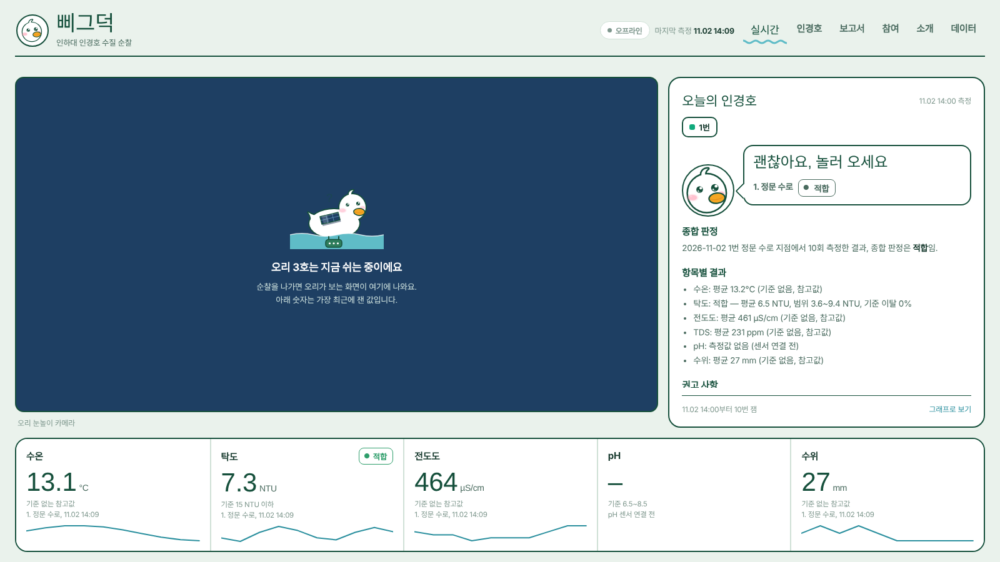

# BbiGeuDeok: Be Green Duck
>Check the water of Ingyeongho pond, measured by a duck robot.

  

  

The middle of the pond is hard to reach, so its water was rarely checked. A duck robot now visits five spots and measures the water. This site shows the results. The duck smiles when the water is fine and looks worried when it is not.

**1. Live:** What the duck sees now, today's report, and the latest readings.

**2. Lake:** A map of the five spots and their past results.

**3. Reports:** A short report for each patrol, with charts.

**4. Join:** Clean-up events and their results.

**5. Data:** Download every measurement as a CSV.

See a problem at the pond? [Tell us](https://github.com/JHC56/bgd-site/issues/new?template=water-report.yml).
